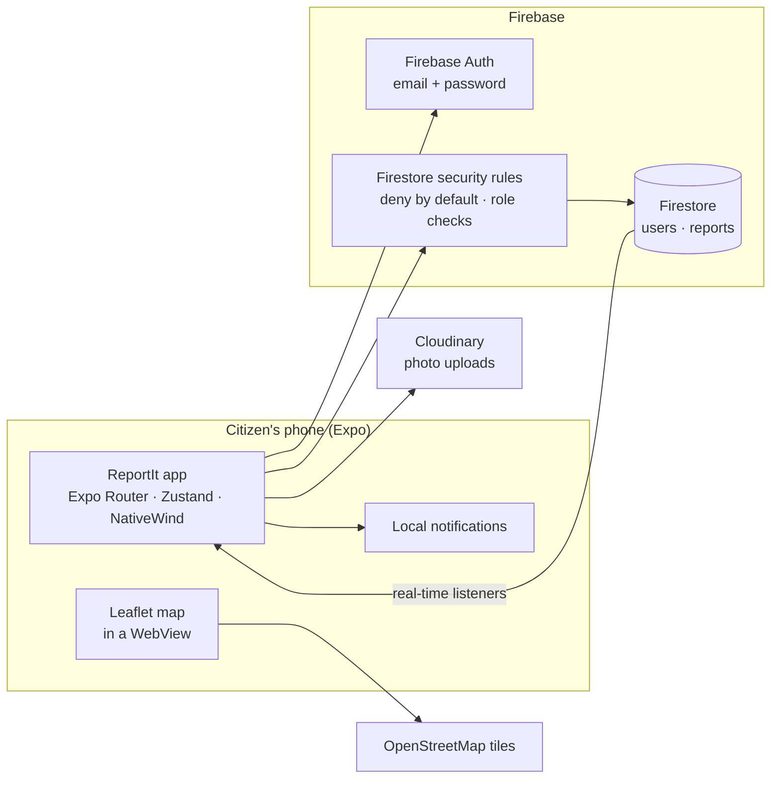

# ReportIt Gambia

Report a pothole, uncollected rubbish, a broken streetlight, a water leak or flooding in under a
minute, with a photo and location, then follow it until it’s fixed.

**Status: working prototype.** Not launched to the public. I’m pitching it to possible backers and
local authorities.

## Project history

ReportIt started as a two-person student project in the original repository,
[missbastimi/Reportit](https://github.com/missbastimi/Reportit). A senior student had the idea and
brought me in to build it with her for her third-year mini-project at KNUST; that version was
ReportIt Ghana, and I built the app. She later handed the project over to me. This repository keeps
the full commit history, and I’m rebuilding and extending it as ReportIt Gambia.

## The problem

Problems at home like potholes, rubbish not being collected, broken streetlights, water leaks and
flooding often don’t get reported, or the report never reaches anyone who can fix it. ReportIt gives
citizens a quick way to report with a photo and exact location, gives administrators one place to
triage reports, and lets the reporter see every status change.

## Features

| Feature | Status |
|---|---|
| Email and password sign-in with a Firestore profile (citizen or admin) | Built |
| First-launch onboarding | Built |
| Report with title, description, category, local government area, photo and GPS location | Built |
| My Reports: a live list with status filters and pull to refresh | Built |
| Public map with colour-coded pins, framed on The Gambia | Built |
| Report detail with a status timeline (Pending → Under Review → In Progress → Resolved, or Rejected with a reason) | Built |
| Admin dashboard with filters, search, notes and quick status changes | Built |
| Local notification when your report’s status changes | Built |
| Gambian categories (flooding, power outage), local government areas, full redesign | Built on `feat/gambia-localization` |
| Routing each report to the right authority (NAWEC, NRA, NDMA, councils) | Next: designed, not built |
| Authority staff role that only sees its own authority’s reports | Next: designed, not built |
| Dated status history | Next: designed, not built |

## Architecture



There is no server of my own. Every read and write goes through the Firestore security rules:

- A user can only create their own profile, only as a `citizen`, and can’t change their own role.
- Profiles can be read only by their owner and by admins. Any signed-in user can read reports, for the public map.
- Only an admin can change a report’s status, and every change must carry the server time.

## Tech stack and why

| Choice | Why |
|---|---|
| Expo / React Native, TypeScript | One codebase for Android and iPhone that runs in Expo Go. |
| Firebase Auth + Firestore | For a small team it was the fastest and cheapest option: login, a live database so status changes show straight away, and security rules on the server, without running a server. |
| Cloudinary | Photo uploads and resizing on the free plan, which helps people with little data. |
| Leaflet + OpenStreetMap | No API key or billing, unlike Google Maps, and it works in Expo Go. |
| Zustand, NativeWind | A small state store and Tailwind-style styling. |

A proper backend for a council dashboard can come later, once the idea is proven.

## Setup

Prerequisites: Node.js 22; a Firebase project with Firestore and Email/Password Authentication
enabled; a Cloudinary account with an **unsigned** upload preset; Expo Go on a phone.

```bash
npm install
cp .env.example .env    # then fill in your own values; .env is never committed
npx expo start
```

Keys in `.env`: `EXPO_PUBLIC_FIREBASE_API_KEY`, `EXPO_PUBLIC_FIREBASE_AUTH_DOMAIN`,
`EXPO_PUBLIC_FIREBASE_PROJECT_ID`, `EXPO_PUBLIC_FIREBASE_STORAGE_BUCKET`,
`EXPO_PUBLIC_FIREBASE_MESSAGING_SENDER_ID`, `EXPO_PUBLIC_FIREBASE_APP_ID`,
`EXPO_PUBLIC_CLOUDINARY_CLOUD_NAME`, `EXPO_PUBLIC_CLOUDINARY_UPLOAD_PRESET`.

**Publish the security rules first.** `firestore.rules` is not deployed automatically: copy it into
the Firebase console (Firestore Database → Rules) and publish it, or Firestore stays on test-mode rules.

## Screenshots

_Add after capture (no real names, faces, addresses or phone numbers):_ home, new report, map,
report detail with timeline, admin. A short demo video is also planned.

## My role

I built the app for the original two-person project, and I now own and develop it on my own:
the mobile app, the Firestore data model and security rules, and the Gambian adaptation.

## Licence

See [LICENSE](LICENSE).
